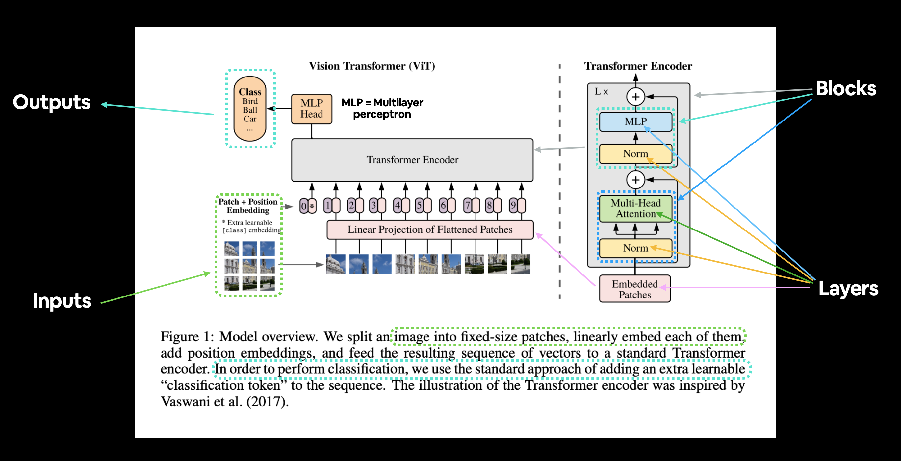
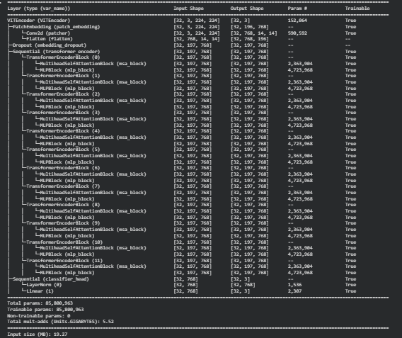
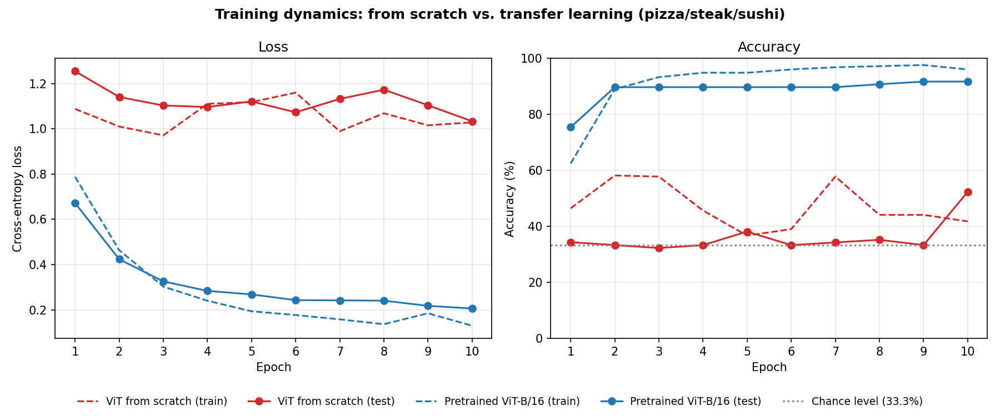
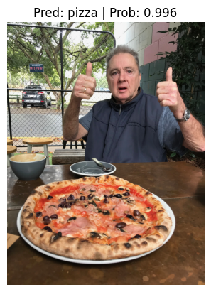

# Replicating the Vision Transformer (ViT) from Scratch


[](https://colab.research.google.com/github/Med00amine/Replicate_ViT_Paper/blob/main/VIT_Paper.ipynb)

> A from-scratch PyTorch implementation of **ViT-Base/16** from *"An Image is Worth 16x16 Words: Transformers for Image Recognition at Scale"* (Dosovitskiy et al., ICLR 2021), with a controlled comparison of **training from scratch** vs. **transfer learning** on a small dataset.

<p align="center">
  
  <br/>
  <em>Figure 1. ViT architecture (paper Fig. 1, annotations from <a href="https://github.com/mrdbourke/pytorch-deep-learning">Bourke</a>). The image is split into 16×16 patches, linearly embedded, prepended with a learnable [class] token, and processed by a standard Transformer encoder.</em>
</p>

---

## Abstract

The ViT paper reports that Transformers *"lack some of the inductive biases inherent to CNNs, such as translation equivariance and locality, and therefore do not generalize well when trained on insufficient amounts of data."* This project tests that claim empirically. I implement every component of ViT-Base from the paper's equations and train it on **~225 images** across 3 classes (pizza, steak, sushi). I then compare it with the same architecture pretrained on ImageNet, with a frozen backbone and only the classification head retrained.

**Result:** the from-scratch model stays at **chance level (~33%)** for 9 of 10 epochs. The pretrained model reaches **91.8%** test accuracy after training only **2,307** parameters (0.003% of the network). This confirms the paper's claim at small scale.

---

## 1. Method

### 1.1 Model equations

The implementation follows the paper's four equations:

$$\mathbf{z}_0 = [\mathbf{x}_\text{class};\ \mathbf{x}^1_p\mathbf{E};\ \mathbf{x}^2_p\mathbf{E};\ \cdots;\ \mathbf{x}^N_p\mathbf{E}] + \mathbf{E}_{pos}, \qquad \mathbf{E}\in\mathbb{R}^{(P^2 C)\times D},\ \mathbf{E}_{pos}\in\mathbb{R}^{(N+1)\times D} \tag{1}$$

$$\mathbf{z}'_\ell = \text{MSA}(\text{LN}(\mathbf{z}_{\ell-1})) + \mathbf{z}_{\ell-1}, \qquad \ell = 1\ldots L \tag{2}$$

$$\mathbf{z}_\ell = \text{MLP}(\text{LN}(\mathbf{z}'_\ell)) + \mathbf{z}'_\ell, \qquad \ell = 1\ldots L \tag{3}$$

$$\mathbf{y} = \text{LN}(\mathbf{z}^0_L) \tag{4}$$

For a 224×224 image with P = 16, there are N = HW/P² = **196 patches**, giving a sequence of **197 tokens** once the [class] token is added.

### 1.2 Mapping paper → code

| Paper | Module | Implementation detail |
|---|---|---|
| Eq. 1: patch + position embedding | `PatchEmbedding` | `Conv2d(3, 768, kernel=16, stride=16)` (equivalent to a linear projection of flattened patches), then flatten |
| Eq. 2: multi-head self-attention | `MultiheadSelfAttentionBlock` | Pre-LayerNorm + `nn.MultiheadAttention(768, 12 heads)` + residual |
| Eq. 3: MLP | `MLPBlock` | LN → Linear(768→3072) → GELU → Dropout → Linear(3072→768) → Dropout + residual |
| Eq. 2–3: encoder layer | `TransformerEncoderBlock` | MSA block followed by MLP block |
| Eq. 4 + head | `VITEncoder` | 12 stacked encoder blocks, LN + Linear on the [class] token |

### 1.3 Hyperparameters (ViT-Base, paper Table 1)

| Layers *L* | Hidden size *D* | MLP size | Heads | Patch size | Dropout | Params |
|:-:|:-:|:-:|:-:|:-:|:-:|:-:|
| 12 | 768 | 3072 | 12 | 16 | 0.1 | **85.8M** |

<p align="center">
  
  <br/>
  <em>Figure 2. <code>torchinfo</code> summary of the from-scratch model: 85,800,963 parameters and 197 tokens × 768 dims through every encoder block. This matches ViT-B/16 exactly.</em>
</p>

---

## 2. Experimental Setup

| | Experiment A: from scratch | Experiment B: transfer learning |
|---|---|---|
| Architecture | Custom `VITEncoder` (ViT-B/16) | `torchvision.models.vit_b_16` |
| Initialization | Random | ImageNet-1k weights (`ViT_B_16_Weights.DEFAULT`) |
| Trainable params | 85,800,963 | **2,307** (head only; backbone frozen) |
| Data | pizza_steak_sushi (~225 train / 75 test) | same |
| Preprocessing | Resize 224×224, ToTensor | same (no ImageNet normalization) |
| Optimizer | Adam, lr = 1e-3 | Adam, lr = 1e-3 |
| Batch size / epochs | 32 / 10 | 32 / 10 |
| Seed | `set_seeds()` (42) | `set_seeds()` (42) |

---

## 3. Results

<p align="center">
  
  <br/>
  <em>Figure 3. Loss and accuracy per epoch, plotted from the training logs in the notebook (<code>scripts/plot_training_curves.py</code>). The from-scratch model (red) stays on the chance line; the pretrained model (blue) converges within 2 epochs.</em>
</p>

| Model | Trainable params | Test loss | Test acc. (final) | Test acc. (mean, epochs 1–10) |
|---|---:|---:|---:|---:|
| ViT-B/16, from scratch | 85.8M | 1.033 | 52.4% | 36.0% |
| ViT-B/16, pretrained + linear head | 2.3K | **0.206** | **91.8%** | **88.8%** |

### Qualitative check

<p align="center">
  
  <br/>
  <em>Figure 4. The pretrained model classifies an unseen photo as <b>pizza</b> with 99.6% confidence.</em>
</p>

---

## 4. Discussion

**Why does the from-scratch ViT fail?** A CNN's convolutions build in two assumptions about images: nearby pixels are related (locality), and a pattern means the same thing wherever it appears (translation equivariance). ViT builds in almost none of this. Apart from the patch split, it has to *learn* spatial structure, starting from position embeddings that are initialized randomly. Learning that takes data: the paper shows ViT only beats ResNets after pretraining on ImageNet-21k (14M images) or JFT-300M. With ~225 images and an 86M-parameter model, the network cannot learn generalizable features. Test accuracy stays near 33% and training loss never falls clearly, which points to an optimization and data problem, not plain overfitting. The jump to 52% at epoch 10 is a single noisy point and should not be read as convergence.

**Why does transfer learning work so well?** The pretrained backbone already encodes general visual features. Training a 2,307-parameter linear head on frozen features is equivalent to logistic regression on very good image embeddings, which is easy even with tiny datasets.

## 5. Limitations

- **Simplified training recipe.** The paper uses Adam with β₂ = 0.999, weight decay 0.1, linear warmup with cosine/linear decay, batch size 4096, and gradient clipping. This run uses plain Adam (lr 1e-3, batch 32), which is likely too aggressive for training a Transformer from scratch.
- **Single seed, tiny test set (75 images).** Each test image is worth ~1.3 accuracy points, so differences of a few percent are not significant.
- **No ImageNet normalization for the pretrained model.** It received the same unnormalized inputs as the from-scratch model; using `ViT_B_16_Weights.DEFAULT.transforms()` would likely improve its accuracy further.
- **No data augmentation.** The from-scratch model gets no regularization beyond dropout.

## 6. Future Work

- [ ] Adopt the paper's optimizer recipe (warmup + cosine decay, weight decay, gradient clipping)
- [ ] Add augmentation (RandAugment, Mixup/CutMix) and compare with **DeiT**-style data-efficient training
- [ ] Try smaller variants (ViT-Ti/S) to study how model size relates to the amount of data
- [ ] Fine-tune the full pretrained backbone instead of only the head
- [ ] Visualize attention maps and learned position embeddings (paper Fig. 7)

---

## Reproducibility

```bash
git clone https://github.com/Med00amine/Replicate_ViT_Paper.git
cd Replicate_ViT_Paper
pip install -r requirements.txt
jupyter notebook VIT_Paper.ipynb          # or use the Colab badge (GPU recommended)
python scripts/plot_training_curves.py    # regenerate Figure 3 from the notebook logs
```

The notebook downloads the dataset and helper modules (`going_modular`, `helper_functions.py`) from [mrdbourke/pytorch-deep-learning](https://github.com/mrdbourke/pytorch-deep-learning) automatically.

```text
.
├── VIT_Paper.ipynb                 # full implementation + experiments
├── scripts/plot_training_curves.py # builds Figure 3 from the notebook outputs
├── images/                         # figures used in this README
└── requirements.txt
```

## References

```bibtex
@inproceedings{dosovitskiy2021vit,
  title     = {An Image is Worth 16x16 Words: Transformers for Image Recognition at Scale},
  author    = {Dosovitskiy, Alexey and Beyer, Lucas and Kolesnikov, Alexander and Weissenborn, Dirk and
               Zhai, Xiaohua and Unterthiner, Thomas and Dehghani, Mostafa and Minderer, Matthias and
               Heigold, Georg and Gelly, Sylvain and Uszkoreit, Jakob and Houlsby, Neil},
  booktitle = {International Conference on Learning Representations (ICLR)},
  year      = {2021}
}
```

- Vaswani et al., *Attention Is All You Need*, NeurIPS 2017.
- Touvron et al., *Training data-efficient image transformers & distillation through attention* (DeiT), ICML 2021.
- Daniel Bourke, [Zero to Mastery: PyTorch for Deep Learning](https://github.com/mrdbourke/pytorch-deep-learning), Section 08: Paper Replicating. The dataset, helper utilities, and annotated figure come from this course.
